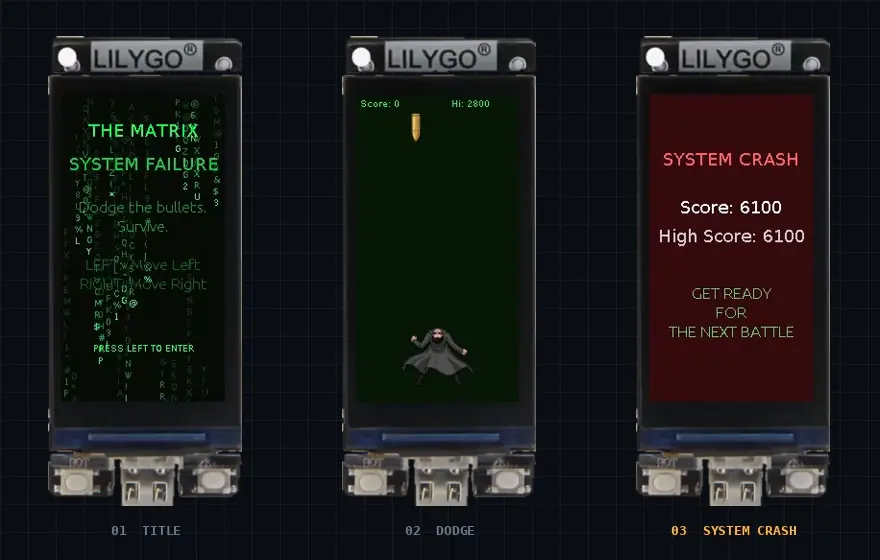
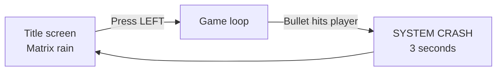

<div align="center">

# NEO

**A Matrix-themed dodge game for the LilyGO T-Display S3, written in C on ESP-IDF.**



</div>

Bullets rain down the screen and you have two buttons to stay alive. Every bullet you dodge scores points, the game gets faster every ten seconds, and one hit brings up the SYSTEM CRASH screen. Your best score survives power cycles in flash.

## Features

- Procedural Matrix rain with 40 independent columns on the title screen
- Frame-rate independent movement using delta time
- A difficulty curve that raises both bullet speed and spawn rate
- A persistent high score stored in NVS
- Sprite rendering with a hitbox tuned tighter than the artwork
- Builds for the T-Display S3, the original T-Display and an emulator

## Controls

| Button | T-Display S3 | T-Display | Action |
| --- | --- | --- | --- |
| Left | GPIO 0 | GPIO 0 | Move left, start the game |
| Right | GPIO 14 | GPIO 35 | Move right |

## How it works



### Game loop

Each frame reads the buttons, spawns and moves bullets, updates the difficulty, checks collisions and draws the result. Movement is scaled by the time since the last frame, capped at 50 ms so a stall can't teleport anything across the screen.

Bullets live in a fixed pool of 20 slots, so the game allocates its memory once per run. A bullet that falls off the bottom frees its slot and scores 100 points.

### Matrix rain

Each of the 40 columns has its own position, speed, trail length (8 to 19 characters) and random symbols. The leading character is drawn brightest and the trail fades through three darker greens. When a column leaves the screen it restarts above the top with new random values.

### Difficulty curve

Difficulty rises one step every 10 seconds:

| Setting | Start | Change per step | Limit | Reached after |
| --- | --- | --- | --- | --- |
| Time between bullets | 1500 ms | -100 ms | 300 ms | 120 s |
| Bullet speed | 120 px/s | +50 px/s | 620 px/s | 100 s |

Bullets already in the air speed up at each step too.

### High score

The high score is stored as a 32-bit integer under the `highscore` key in the `storage` NVS namespace. It's written as soon as your score passes the old record, so it's saved even if the power is cut mid-run.

## Project layout

| File | Purpose |
| --- | --- |
| `src/main.c` | Game loop, rain, rendering and difficulty |
| `src/input_output.c` | Button setup and NVS storage |
| `src/neo_main.c` | Player sprite (80x73 RGBA) |
| `src/bullet_main.c` | Bullet sprite (64x35 RGBA) |

## Build and run

You'll need [PlatformIO](https://platformio.org/). It downloads the toolchain and libraries on the first build.

```bash
# Build and flash a T-Display S3
pio run -e tdisplay_s3 -t upload

# Build and flash an original T-Display
pio run -e tdisplay -t upload

# Run in the emulator
pio run -e emulator_s3 -t upload
```

## Credits

- [TDisplayGraphics](https://github.com/a159x36/TDisplayGraphics) by a159x36: display, font and image drawing
- [T-Display emulator](https://github.com/a159x36/qemu) by a159x36: QEMU-based emulator
- [ESP-IDF](https://github.com/espressif/esp-idf) by Espressif: framework and NVS

Neo is an unofficial fan project and isn't affiliated with or endorsed by the owners of The Matrix.

## Licence

The source code is available under the [MIT licence](LICENSE). The sprite artwork in `src/neo_main.c` and `src/bullet_main.c` isn't covered by this licence.
